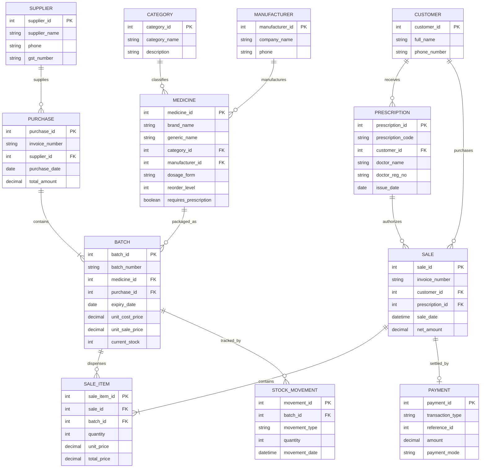

# REVIEW 1: Conceptual Design & Relational Schema
## Project 04: Pharmacy Prescription and Medicine Stock Management System
**Course:** Database Management Systems (PBL)  
**Evaluation:** Review 1 (Week 7 — 5 Marks)  

---

### 1. Problem Identification & Motivation
In traditional and manual pharmacy setups, medicine inventory, prescriptions, supplier purchases, and customer retail transactions are typically managed through paper records, loose bills, or disconnected spreadsheets. This manual workflow gives rise to several critical challenges:
1. **Accidental Dispensation of Expired Drugs:** Without an automated batch-level tracking system, pharmacists risk selling medicines past their expiry date, endangering patient safety and violating regulatory health codes.
2. **Stock-Outs and Overstocking:** Lack of automated reorder warnings leads to sudden shortages of life-saving medicines or excess capital locked in slow-moving drugs.
3. **Prescription Compliance Violations:** Schedule H and restricted prescription medicines are often dispensed without validating doctor details, prescription dates, or permitted quantities.
4. **Weak Batch Traceability:** In case of manufacturer recalls or defect warnings, tracing which customer bought an affected batch is impossible with manual logs.
5. **Billing Inconsistencies & Financial Leakage:** Manual calculations cause billing discrepancies, unmonitored profit margins, and untracked supplier payables.

---

### 2. Scope & Objectives
The goal of this project is to design, normalize, and implement an end-to-end relational database management system (RDBMS) paired with an application layer to streamline retail pharmacy operations.

#### Core Objectives:
- **Batch-Level Inventory Control:** Maintain precise batch records (`batch_number`, `manufacture_date`, `expiry_date`, `purchase_price`, `selling_price`, `current_stock`).
- **Safety Enforcement:** Enforce automated rules that strictly prevent the sale of expired medicines or quantities exceeding batch stock.
- **Prescription Validation:** Record doctor credentials, patient details, validity periods, and map restricted medicines to verified prescriptions.
- **End-to-End Procurement & Sales:** Track supplier purchases, purchase invoices, customer sales bills, and itemized billing.
- **Reporting & Business Analytics:** Generate real-time reports on stock availability, near-expiry alerts (30/60/90 days), fast-moving medicines, supplier purchase summaries, and net profitability.

---

### 3. User Roles & Access Hierarchy
| User Role | Responsibilities | Privileges |
| :--- | :--- | :--- |
| **Pharmacy Administrator / Owner** | Store configuration, supplier management, pricing policies, financial audits, profit reports | Full administrative access to all tables, schemas, and reports |
| **Pharmacist / Dispenser** | Prescription validation, dispensing medicines, sales billing, customer registration | Read inventory, Create/Read prescriptions, Create sales & sale items, View expiry alerts |
| **Inventory / Store Keeper** | Receiving purchase shipments, batch registration, stock replenishment, logging damaged/expired returns | Read/Write purchases, batches, suppliers, and stock movement logs |

---

### 4. Functional Requirements
1. **FR1 - Medicine & Category Management:** Categorize medicines (e.g., Antibiotics, Analgesics, Antidiabetics, Antipyretics) and record dosage form, strength, manufacturer, and prescription requirement (`requires_prescription`).
2. **FR2 - Supplier & Purchase Tracking:** Record supplier contact details and log purchase orders containing itemized batch details, costs, and received quantities.
3. **FR3 - Batch Stock & Expiry Control:** Track stock per batch. Prohibit billing from expired batches. Highlight batches expiring within 30, 60, or 90 days.
4. **FR4 - Prescription Handling:** Record prescribing doctor name, hospital/clinic, registration number, patient name, and prescription date before dispensing restricted medicines.
5. **FR5 - Sales & Invoicing:** Support multi-item sales transactions. Automatically calculate subtotal, discounts, tax, and net payable. Update batch stock in real-time.
6. **FR6 - Stock Movement Audit:** Record all inventory fluctuations (Purchase In, Sale Out, Return In, Expiry Disposal) to maintain an unalterable audit trail.
7. **FR7 - Reporting & Analytics:**
   - Current Stock Valuation Report
   - Near-Expiry Batches Warning
   - Fast-Moving Medicines (Top Sellers)
   - Supplier Procurement Summary
   - Daily / Monthly Sales and Gross Margin (Profit) Report

---

### 5. Principal Entities & Attribute Dictionary
As specified in the PBL guidelines, the database models the following 12 core entities:

1. **Category:** `category_id` (PK), `category_name`, `description`
2. **Manufacturer:** `manufacturer_id` (PK), `company_name`, `contact_email`, `phone`, `address`
3. **Supplier:** `supplier_id` (PK), `supplier_name`, `gst_number`, `contact_person`, `phone`, `email`, `address`
4. **Medicine:** `medicine_id` (PK), `brand_name`, `generic_name`, `category_id` (FK), `manufacturer_id` (FK), `dosage_form` (Tablet/Syrup/Injection), `strength`, `reorder_level`, `requires_prescription`
5. **Purchase:** `purchase_id` (PK), `invoice_number`, `supplier_id` (FK), `purchase_date`, `total_amount`, `payment_status`
6. **Batch:** `batch_id` (PK), `batch_number`, `medicine_id` (FK), `purchase_id` (FK), `manufacture_date`, `expiry_date`, `unit_cost_price`, `unit_sale_price`, `initial_quantity`, `current_stock`
7. **Customer:** `customer_id` (PK), `full_name`, `phone_number`, `email`, `gender`, `address`
8. **Prescription:** `prescription_id` (PK), `prescription_code`, `customer_id` (FK), `doctor_name`, `doctor_reg_no`, `clinic_name`, `issue_date`, `notes`
9. **Sale:** `sale_id` (PK), `invoice_number`, `customer_id` (FK), `prescription_id` (FK - nullable for OTC), `sale_date`, `subtotal`, `discount_amount`, `tax_amount`, `net_amount`, `payment_method`
10. **SaleItem:** `sale_item_id` (PK), `sale_id` (FK), `batch_id` (FK), `quantity`, `unit_price`, `total_price`
11. **StockMovement:** `movement_id` (PK), `batch_id` (FK), `movement_type` (PURCHASE, SALE, RETURN, EXPIRED_DISPOSAL), `quantity`, `movement_date`, `reference_id`, `remarks`
12. **Payment:** `payment_id` (PK), `transaction_type` (CUSTOMER_SALE / SUPPLIER_PAYMENT), `reference_id`, `payment_date`, `amount`, `payment_mode`, `transaction_status`

---

### 6. Conceptual Entity-Relationship (ER) Diagram
The following Mermaid diagram visualizes the entity relationships, cardinalities, and foreign key connections:

---

### 7. Initial Relational Schema
The conceptual ER diagram translates to the following relational schema:

1. **`categories`** (`category_id` [PK], `category_name`, `description`)
2. **`manufacturers`** (`manufacturer_id` [PK], `company_name`, `contact_email`, `phone`, `address`)
3. **`suppliers`** (`supplier_id` [PK], `supplier_name`, `gst_number`, `contact_person`, `phone`, `email`, `address`)
4. **`medicines`** (`medicine_id` [PK], `brand_name`, `generic_name`, `category_id` [FK $\rightarrow$ categories], `manufacturer_id` [FK $\rightarrow$ manufacturers], `dosage_form`, `strength`, `reorder_level`, `requires_prescription`)
5. **`purchases`** (`purchase_id` [PK], `invoice_number`, `supplier_id` [FK $\rightarrow$ suppliers], `purchase_date`, `total_amount`, `payment_status`)
6. **`batches`** (`batch_id` [PK], `batch_number`, `medicine_id` [FK $\rightarrow$ medicines], `purchase_id` [FK $\rightarrow$ purchases], `manufacture_date`, `expiry_date`, `unit_cost_price`, `unit_sale_price`, `initial_quantity`, `current_stock`)
7. **`customers`** (`customer_id` [PK], `full_name`, `phone_number`, `email`, `gender`, `address`)
8. **`prescriptions`** (`prescription_id` [PK], `prescription_code`, `customer_id` [FK $\rightarrow$ customers], `doctor_name`, `doctor_reg_no`, `clinic_name`, `issue_date`, `notes`)
9. **`sales`** (`sale_id` [PK], `invoice_number`, `customer_id` [FK $\rightarrow$ customers], `prescription_id` [FK $\rightarrow$ prescriptions, NULLABLE], `sale_date`, `subtotal`, `discount_amount`, `tax_amount`, `net_amount`, `payment_method`)
10. **`sale_items`** (`sale_item_id` [PK], `sale_id` [FK $\rightarrow$ sales], `batch_id` [FK $\rightarrow$ batches], `quantity`, `unit_price`, `total_price`)
11. **`stock_movements`** (`movement_id` [PK], `batch_id` [FK $\rightarrow$ batches], `movement_type`, `quantity`, `movement_date`, `reference_id`, `remarks`)
12. **`payments`** (`payment_id` [PK], `transaction_type`, `reference_id`, `payment_date`, `amount`, `payment_mode`, `transaction_status`)

This schema completely covers all requirements for Review 1 (Week 7).
